<div align="center">


# VizLab

**인터랙티브 데이터 시각화 백과사전**

데이터를 탐색하고, 직접 조작하고, 서로 다른 시각화의 원리를 비교합니다.


### [VizLab 시작하기](https://oyueo-mm.github.io/VizLab/)

[도감](https://oyueo-mm.github.io/VizLab/#/catalog) · [비교 실험실](https://oyueo-mm.github.io/VizLab/#/compare) · [개발 기록](CHANGELOG.md)

| **360** | **17** | **78** | **100** |
| :---: | :---: | :---: | :---: |
| 시각화 | 카테고리 | 비교 프리셋 | 홈 애니메이션 단계 |

<a href="https://oyueo-mm.github.io/VizLab/#/catalog">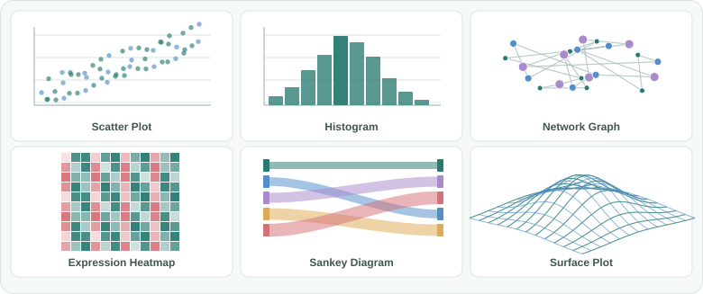</a>

<sub>대표 시각화의 예시 그림 · 클릭하면 실제 도감으로 이동합니다.</sub>

</div>

## 주요 기능

| 기능 | 설명 |
| :--- | :--- |
| [시각화 도감](https://oyueo-mm.github.io/VizLab/#/catalog) | 실제 렌더링 미리보기, 한·영 검색, 카테고리·성격·표현 원리·데이터 유형 필터 |
| [인터랙티브 실험실](https://oyueo-mm.github.io/VizLab/#/viz/scatter) | 데이터와 매개변수 직접 조작, 실시간 결과, 실행 취소·다시 실행 |
| [비교 실험실](https://oyueo-mm.github.io/VizLab/#/compare) | 같은 데이터를 2~3개 차트로 비교, 독립 설정, 일부 차트 간 연결 강조 |
| 데이터 편집 | 표 편집, CSV·JSON 가져오기·내보내기, 시드 기반 재현 |
| 이론 학습 | 정의, 수식, 작동 원리, 장단점, 유사 기법 및 참고문헌 |

설치나 로그인 없이 브라우저에서 사용할 수 있습니다. 사용자 데이터는 브라우저 내부에서 처리됩니다.

## 시각화 갤러리

카테고리 이름 또는 그림을 클릭하면 해당 도감으로 이동합니다. 아래 SVG는 대표 기법을 설명하는 예시 그림이며 실제 앱 화면 캡처는 아닙니다.

| | | |
| :---: | :---: | :---: |
| <a href="https://oyueo-mm.github.io/VizLab/#/catalog/distribution">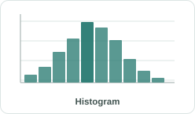<br><b>분포</b></a><br><sub>히스토그램 · KDE · 바이올린</sub> | <a href="https://oyueo-mm.github.io/VizLab/#/catalog/relationship">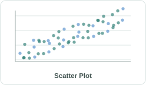<br><b>관계</b></a><br><sub>산점도 · 버블 · 헥스빈</sub> | <a href="https://oyueo-mm.github.io/VizLab/#/catalog/comparison">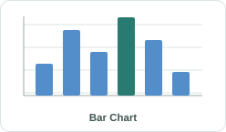<br><b>비교</b></a><br><sub>막대 · 덤벨 · 롤리팝</sub> |
| <a href="https://oyueo-mm.github.io/VizLab/#/catalog/timeseries">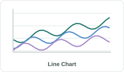<br><b>시계열</b></a><br><sub>선 · 범프 · 호라이즌</sub> | <a href="https://oyueo-mm.github.io/VizLab/#/catalog/composition">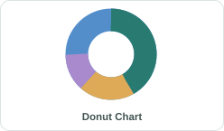<br><b>비율·구성</b></a><br><sub>도넛 · 트리맵 · 선버스트</sub> | <a href="https://oyueo-mm.github.io/VizLab/#/catalog/multivariate">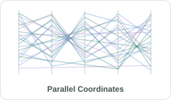<br><b>다변량</b></a><br><sub>평행좌표 · PCA · RadViz</sub> |
| <a href="https://oyueo-mm.github.io/VizLab/#/catalog/hierarchy">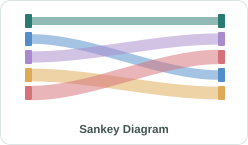<br><b>계층·흐름</b></a><br><sub>생키 · 아이시클 · 덴드로그램</sub> | <a href="https://oyueo-mm.github.io/VizLab/#/catalog/uncertainty">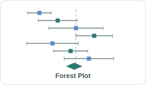<br><b>통계·불확실성</b></a><br><sub>포레스트 · 신뢰구간 · Q-Q</sub> | <a href="https://oyueo-mm.github.io/VizLab/#/catalog/geo"><br><b>지리공간</b></a><br><sub>코로플레스 · 타일 그리드 · 카토그램</sub> |
| <a href="https://oyueo-mm.github.io/VizLab/#/catalog/network">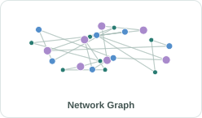<br><b>관계·네트워크</b></a><br><sub>네트워크 · NodeTrix · Bubble Sets</sub> | <a href="https://oyueo-mm.github.io/VizLab/#/catalog/special">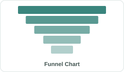<br><b>특수·응용</b></a><br><sub>퍼널 · 간트 · 플레임</sub> | <a href="https://oyueo-mm.github.io/VizLab/#/catalog/science">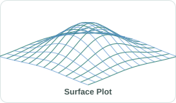<br><b>과학·수학</b></a><br><sub>3D 곡면 · 프랙탈 · 벡터장</sub> |
| <a href="https://oyueo-mm.github.io/VizLab/#/catalog/bio">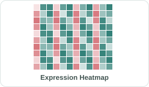<br><b>생물정보학</b></a><br><sub>발현 히트맵 · 유전체 · 계통</sub> | <a href="https://oyueo-mm.github.io/VizLab/#/catalog/finance">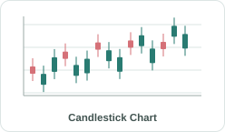<br><b>금융·경제</b></a><br><sub>캔들스틱 · 수익률 · 위험</sub> | <a href="https://oyueo-mm.github.io/VizLab/#/catalog/industry">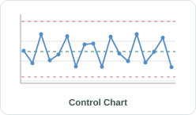<br><b>산업·공학</b></a><br><sub>관리도 · 공정 · 신뢰성</sub> |
| <a href="https://oyueo-mm.github.io/VizLab/#/catalog/text"><br><b>언어·텍스트</b></a><br><sub>워드 클라우드 · 워드 트리 · TextArc</sub> | <a href="https://oyueo-mm.github.io/VizLab/#/catalog/ml">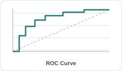<br><b>기계학습·AI</b></a><br><sub>ROC · UMAP · SHAP</sub> |  |

## 기술적 특징

- **실제 계산 엔진** — KDE, ECDF, PCA, ROC·PR, 통계적 추정, 지리 투영 및 그래프 레이아웃 등
- **렌더링 최적화** — SVG·Canvas, 차트 단위 지연 로딩, 큰 네트워크 레이아웃의 Web Worker 분리
- **재현 가능한 실험** — 시드 기반 데이터, 독립적인 매개변수, 데이터 호환성 검사
- **검증** — v1.1 기준 단위 테스트 871개 통과, Playwright 브라우저 테스트 및 GitHub Actions 배포 기록 ([검증 상세](docs/v11-progress.md))

교육용 구현 및 근사 기법도 포함하며, 모든 시각화가 원 논문의 완전한 재현인 것은 아닙니다. [구현·검증 한계](docs/limitations.md)를 참고하세요.

## 기술 스택

| 영역 | 기술 |
| :--- | :--- |
| Frontend | React 19, TypeScript, Vite, Tailwind CSS |
| Visualization | D3.js, SVG, Canvas, topojson-client |
| Math / Layout | KaTeX, 통계·레이아웃 계산 모듈 |
| Testing / Deployment | Vitest, Playwright, GitHub Actions, GitHub Pages |

## 로컬 실행

```bash
git clone https://github.com/oyueo-mm/VizLab.git
cd VizLab
npm ci
npm run dev
```

접속: http://127.0.0.1:5173/VizLab/

<details>
<summary>빌드 및 테스트</summary>

```bash
npm run typecheck
npm run lint
npm test
npm run build
npx playwright install chromium
npm run test:e2e
```

</details>

## 프로젝트 구조

```text
src/
├── viz/        시각화 레지스트리 및 차트 모듈
├── stats/      통계 및 계산 엔진
├── data/       데이터셋 및 테이블 모델
├── geo/        지도 데이터 및 투영
├── compare/    비교 실험실
├── lab/        개별 실험실 및 데이터 편집
├── content/    시각화 설명 콘텐츠
└── pages/      홈 및 도감 화면
```

## 개발 문서

| 문서 | 내용 |
| :--- | :--- |
| [CHANGELOG](CHANGELOG.md) | 버전별 변경 기록 |
| [Architecture](docs/architecture.md) | 시스템 구조 및 계산 엔진 |
| [Performance](docs/performance.md) | 성능 측정과 최적화 기록 |
| [Limitations](docs/limitations.md) | 구현 범위 및 검증 한계 |
| [Research](docs/v11-research.md) · [Inventory](docs/v11-inventory.md) | v1.1 기법별 서지 및 구현 내역 |
| [기존 README 보관본](docs/readme-v1.1-archive.md) | 개편 이전 전체 기록 |
| [NOTICE](NOTICE.md) | 외부 데이터 및 출처 |

## 향후 개발

WebGL 3D 및 대용량 차트, 추가 연결 강조, 이미지 내보내기, 세분화된 지도와 전문 시각화. 자세한 내용은 [v1.1 후속 과제](docs/v11-next.md)를 참고하세요.
